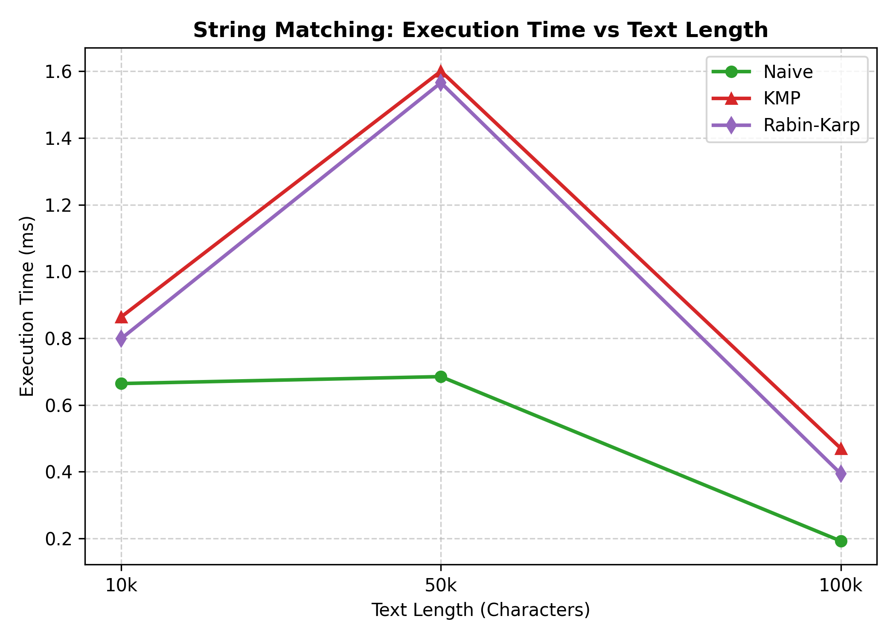

# Assignment 4: Text Analysis (Dynamic Programming & String Algorithms)

---

### Project Structure

```text
DAA-Assignment-4/
├── plots/
│   ├── dp runtime.png
│   └── matchingruntime.png
├── src/
│   ├── advanced/
│   │   └── KasaiLCP.java
│   ├── benchmark/
│   │   └── BenchmarkRunner.java
│   ├── dp/
│   │   ├── ED.java
│   │   └── LCS.java
│   ├── sm/
│   │   └── StringMatchers.java
│   └── test/
│       └── AlgorithmCorrectnessTest.java
├── table result/
│   └── img.png
└── README.md
```
---

## 1. Problem Description & Algorithms

### Part A. Dynamic Programming
1. **Longest Common Subsequence (LCS):**
    * **Goal:** Find the length of the longest subsequence present in both strings in the same order (characters do not have to be side-by-side).
    * **Recurrence:**
      $$DP[i][j] = \begin{cases} DP[i-1][j-1] + 1 & \text{if } A[i-1] == B[j-1] \\ \max(DP[i-1][j], DP[i][j-1]) & \text{otherwise} \end{cases}$$
    * **Base cases:** $DP[i][0] = 0$ and $DP[0][j] = 0$.
    * **Why it works:** If two characters match, we can safely add 1 to the best result of the shorter prefixes. If they don't, we pick the best result by ignoring the last character from either string $A$ or string $B$.

2. **Edit Distance (Levenshtein Distance):**
    * **Goal:** Find the minimum number of insertions, deletions, and substitutions needed to change string $A$ into string $B$.
    * **Recurrence:**
      $$DP[i][j] = \begin{cases} DP[i-1][j-1] & \text{if } A[i-1] == B[j-1] \\ 1 + \min(DP[i-1][j], DP[i][j-1], DP[i-1][j-1]) & \text{otherwise} \end{cases}$$
    * **Base cases:** $DP[i][0] = i$ (deleting all $i$ chars) and $DP[0][j] = j$ (inserting all $j$ chars).
    * **Why it works:** At each step, if characters differ, we try all three basic edits (delete, insert, replace) and choose the one with the smallest cost.

### Part B. String Matching
1. **Naive Matching:** Checks every position in the text one by one. Simple baseline.
2. **Knuth-Morris-Pratt (KMP):**
    * Uses an LPS (Longest Proper Prefix which is also Suffix) array built from the pattern.
    * **Why no backtracking:** When a mismatch occurs, the LPS table tells us where the next valid match could start inside the pattern. The text pointer never moves backward.
3. **Rabin-Karp:**
    * Computes a rolling hash of the pattern and a sliding window in the text.
    * **Handling collisions:** When window hash equals pattern hash, it checks each character one by one to ensure it is not a false positive (hash collision).

### Part C. Advanced String Algorithm: Kasai's Algorithm
* **What LCP is:** Longest Common Prefix array. For a sorted suffix array $SA$, $LCP[i]$ is the length of the common prefix between suffix $SA[i]$ and suffix $SA[i-1]$.
* **Linear Time ($O(n)$):** Kasai's key observation is that when checking suffixes in original text order, the LCP value drops by at most 1 from one position to the next ($h \ge h - 1$). Since $h$ increases at most $n$ times in total, the algorithm runs in strictly $O(n)$ time.

---

## 2. Implementation Decisions & Assumptions

* **Empty Pattern:** If the pattern is empty (`""`) or `null`, search methods return an empty list `[]`.
* **Pattern longer than text:** Returns an empty list immediately.
* **0-based indexing:** All reported match positions are 0-based.
* **Suffix Array:** Kasai's algorithm takes a pre-built suffix array as input, as permitted by the task.

---

## 3. Complexity Analysis Table

| Algorithm | Main Formula / Operation | Time (Best) | Time (Worst) | Space | Explanation |
| :--- | :--- | :---: | :---: | :---: | :--- |
| **LCS** | $DP[i][j] = DP[i-1][j-1]+1$ or $\max$ | $\Theta(m \cdot n)$ | $\Theta(m \cdot n)$ | $O(m \cdot n)$ | Fills an $(m+1) \times (n+1)$ 2D array. |
| **Edit Distance** | $1 + \min(\text{del}, \text{ins}, \text{sub})$ | $\Theta(m \cdot n)$ | $\Theta(m \cdot n)$ | $O(m \cdot n)$ | Fills an $(m+1) \times (n+1)$ 2D array. |
| **Naive Matching** | Character-by-character scan | $\Omega(n)$ | $O(n \cdot m)$ | $O(1)$ | Best case fails on 1st char; worst case on repeated chars like `"AAAA"`. |
| **KMP** | LPS array lookup + text scan | $\Theta(n + m)$ | $\Theta(n + m)$ | $O(m)$ | LPS array takes $O(m)$; search never backtracks on text ($O(n)$). |
| **Rabin-Karp** | Rolling hash update modulo $q$ | $\Theta(n + m)$ | $O(n \cdot m)$ | $O(1)$ | Expected $O(n+m)$ with rare collisions; worst case if every window collides. |
| **Kasai's LCP** | Height decrement $h = \max(0, h-1)$ | $\Theta(n)$ | $\Theta(n)$ | $O(n)$ | Inverts SA to rank array; counter $h$ increments at most $n$ times. |

---

## 4. Testing Strategy & Results

Unit tests are written in JUnit 5 (`AlgorithmCorrectnessTest.java`):

* **LCS:** Tested identical strings (`"ABCDE"` $\to$ 5), completely different strings (`"ABC"`, `"XYZ"` $\to$ 0), and empty strings (`""` $\to$ 0). All passed.
* **Edit Distance:** Tested identical strings (0), empty string vs text, and single operations (insert, delete, substitute). All passed.
* **String Matching Consistency:** Verified that Naive, KMP, and Rabin-Karp return identical index lists for:
    * Pattern at start, middle, and end.
    * Overlapping occurrences (`"AAAAA"` with `"AA"`).
    * Absent patterns and patterns longer than text.
    * Empty patterns.
* **Kasai's Algorithm:** Tested on `"banana"` with manually verified suffix array `[5, 3, 1, 0, 4, 2]`. Expected LCP `[0, 1, 3, 0, 0, 2]` was confirmed.

---

## 5. Experimental Setup & Timing Methodology

* **Workloads:**
    * LCS & Edit Distance: lengths 100, 500, 1,000.
    * String Matching: text lengths 10,000, 50,000, 100,000 (both present and absent patterns).
    * Kasai: lengths 1,000, 5,000, 10,000.
* **Randomness & Alphabet:** Fixed seed (`Random(42)`) using uppercase English letters `A-Z`.
* **Timing:** `System.nanoTime()` measured strictly around algorithm execution. Data generation and printing were excluded.
* **Repetitions:** Each test was executed 5 times and averaged.

---

## 6. Experimental Results & Plots

### Benchmark Data Tables

#### Part A: Dynamic Programming
| Input Size (N) | LCS Avg Time (ms) | Edit Distance Avg Time (ms) |
| :---: | :---: | :---: |
| 100 | 0.8977 | 1.2122 |
| 500 | 5.9869 | 6.0988 |
| 1000 | 5.0376 | 4.3293 |

#### Part B: String Matching
| Text Length (N) | Pattern Status | Naive (ms) | KMP (ms) | Rabin-Karp (ms) |
| :---: | :---: | :---: | :---: | :---: |
| 10,000 | Present | 0.6643 | 0.8634 | 0.7984 |
| 10,000 | Absent | 0.5242 | 1.0002 | 0.5162 |
| 50,000 | Present | 0.6851 | 1.5999 | 1.5654 |
| 50,000 | Absent | 0.2099 | 0.4362 | 0.8938 |
| 100,000 | Present | 0.1926 | 0.4701 | 0.3942 |
| 100,000 | Absent | 0.1470 | 0.3501 | 0.3922 |

#### Part C: Kasai's LCP Algorithm
| Input Size (N) | Kasai LCP Avg Time (ms) |
| :---: | :---: |
| 1,000 | 0.1556 |
| 5,000 | 0.6707 |
| 10,000 | 0.3734 |

### Plot 1: Execution Time vs Input Size for LCS and Edit Distance


### Plot 2: Execution Time vs Text Length for Naive, KMP, and Rabin-Karp



### Table Result: Testing Strategy and Results

All edge cases and correctness requirements were verified using JUnit 5 tests. All 12 unit tests passed successfully.

| Category / Algorithm | Test Case | Description / Edge Case | Status | Execution Time |
| :--- | :--- | :--- | :---: | :---: |
| **LCS** | `testLCS_IdenticalStrings()` | Two identical strings (`"ABCDE"`, `"ABCDE"`) | Passed | 1 ms |
| | `testLCS_CompletelyDifferentStrings()` | Disjoint alphabets (`"ABC"`, `"XYZ"`) | Passed | 1 ms |
| | `testLCS_EmptyString()` | One or both strings are empty (`""`) | Passed | 2 ms |
| **Edit Distance** | `testEditDistance_IdenticalStrings()` | Zero operations needed (`"KITTEN"`, `"KITTEN"`) | Passed | 1 ms |
| | `testEditDistance_EmptyString()` | Empty string against non-empty string | Passed | 1 ms |
| | `testEditDistance_Operations()` | Verifies insertion, deletion, and substitution | Passed | 18 ms |
| **String Matching** | `testStringMatching_Positions()` | Pattern at start, middle, and end of text | Passed | 1 ms |
| *(Naive, KMP, RK)* | `testStringMatching_MultipleAndOverlapping()` | Repeated and overlapping occurrences (`"AA"` in `"AAAAA"`) | Passed | 1 ms |
| | `testStringMatching_Absent()` | Pattern not present in text | Passed | 1 ms |
| | `testStringMatching_PatternLongerThanText()` | Pattern length exceeds text length | Passed | 3 ms |
| | `testStringMatching_EmptyPattern()` | Empty pattern handling (returns empty list) | Passed | 1 ms |
| **Kasai's LCP** | `testKasaiLCP_Banana()` | Manual verification on `"banana"` against expected LCP array | Passed | 2 ms |

> **Invariant Verification:** For all string matching tests, `assertAllMatchersEqual()` verified that Naive, KMP, and Rabin-Karp return identical index lists.

#### Screenshot of test results


---

## 7. Discussion

* **Dynamic Programming:** Both LCS and Edit Distance show quadratic growth ($O(N^2)$). Edit Distance takes slightly longer because it compares three branch possibilities instead of two. Later runs benefited from JVM JIT compilation, which optimized loops after initial iterations.
* **String Matching on Random Text:** On a 26-character random alphabet, characters mismatch on the first comparison over 96% of the time. Because of this, Naive matching runs close to $O(n)$ in practice and is very fast with no memory overhead. KMP and Rabin-Karp add small overheads (LPS array and modulo arithmetic), but KMP remains the safest choice for predictable linear time without worst-case degradation.
* **Kasai's Algorithm:** Runs in under 1 ms even on 10,000 characters, experimentally confirming its $O(n)$ theoretical bound.

---

## 8. Conclusion & Trade-offs

* **LCS & Edit Distance:** Great for optimal string alignment and diff tools, but too slow for very long texts due to $O(N^2)$ memory and time.
* **Naive Matching:** Best for quick searches in standard text with a large alphabet due to simple implementation and zero auxiliary memory.
* **KMP:** Best general-purpose string matcher when input might contain repetitive patterns (e.g., DNA, binary data) or when processing a non-rewindable input stream.
* **Rabin-Karp:** Ideal when searching for multiple patterns at once using rolling hash comparisons.
* **Kasai's Algorithm:** Very fast $O(n)$ way to extract shared prefix information once a suffix array is available.